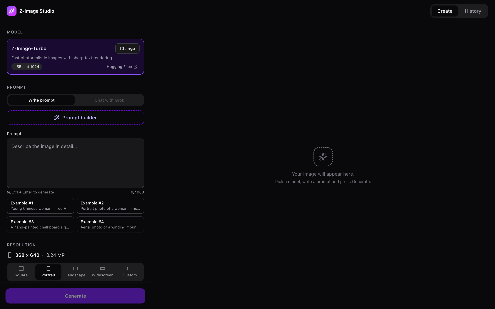

# Z-Image Inference on Apple Silicon



> Generate images locally on your Mac with Z-Image-Turbo, two SDXL anime models and MOSS-Image, from a clean web interface. Nothing leaves your machine.

Z-Image Inference runs image generation models natively on Apple Silicon (MLX and Metal) and gives them a friendly browser UI: write or build a prompt, pick a model and a size, and generate. Every image is kept in a searchable History, where you can browse, compare, edit and make variations of it.

| Model | Best for |
|-------|----------|
| [Z-Image-Turbo](https://huggingface.co/Tongyi-MAI/Z-Image-Turbo) (default) | Fast photorealistic images, including readable text |
| [WAI-NSFW-Illustrious v12](https://huggingface.co/votepurchase/waiNSFWIllustrious_v120) (SDXL) | Anime and illustration styles |
| [Anime Desire](https://huggingface.co/AI-Porn/anime-desire-illustrious) (Illustrious SDXL) | Anime and hentai styles, with Danbooru tags |
| [MOSS-Image NSFW](https://huggingface.co/axiomofmind/Moss-image-nsfw-uncensored-lora) | Photorealistic adult content (slow) |

Only Z-Image-Turbo downloads by itself; you add or remove the others from the app.

## Highlights

- **Runs entirely on your Mac**, with live progress, Cancel, and a notification when a long render finishes
- **Prompt builder**: assemble a detailed prompt step by step for a purpose (portrait, fashion, scene, 18+ and more), written as a rich description or as weighted tags to suit each model
- **Prompt weights and long prompts** (`(tag:1.3)`) on the SDXL models, with nothing cut off after 77 tokens
- **Variations**: start a new image from one you made, with a slider for how much it may change
- **History**: search, filter by model, ratio and favourites, page through it, compare two images side by side, and export a zip
- **Image viewer and editor**: browse with the arrow keys, zoom to 100%, go full screen, see the colour palette, and rotate, flip or crop into a new copy
- **Chat with Grok** (optional) to turn a plain description into a detailed prompt
- **Light and dark mode**, keyboard shortcuts, and settings remembered between visits

## Requirements

- A Mac with Apple Silicon; 24 GB of memory is comfortable (tested on an M5 with 24 GB)
- macOS, [uv](https://github.com/astral-sh/uv) (it installs Python 3.12+ for you) and [Node.js](https://nodejs.org/) 20+
- Disk space: about 45 GB for Z-Image-Turbo (its original plus the 8-bit copy it runs), more for each extra model ([sizes](docs/models.md#download-sizes))

## Quick start

```bash
git clone https://github.com/amirzenoozi/z-image-inference.git
cd z-image-inference
uv sync
cd frontend && npm ci && npm run build && cd ..
```

Then run the two parts, each in its own terminal:

```bash
uv run python model_server.py   # loads and runs the models
uv run python main.py           # the web app
```

Open **http://127.0.0.1:7860**. The first start downloads Z-Image-Turbo (about 33 GB) and builds its 8-bit copy, so it takes a while once; after that it starts in seconds.

## Settings

Optional, in a `.env` file in the project folder:

| Variable | What it does |
|----------|--------------|
| `XAI_API_KEY` | Turns on **Chat with Grok** ([xAI API key](https://x.ai/)) |
| `Z_IMAGE_BITS` | Which Z-Image-Turbo copy to run: `8` (default), `6`, `5`, `4`, `3`, or `original` |
| `MODEL_COMPRESSION` | `on` keeps smaller compressed copies of the other models instead of their originals |

Restart the model server after changing them. See [Models](docs/models.md) for what each setting changes.

## Documentation

- [Using the app](docs/usage.md): creating images, the prompt builder, prompt weights, Grok chat, History, the viewer, the editor and variations
- [Models](docs/models.md): the four models, their defaults, downloading and removing them, compression and Z-Image-Turbo's levels
- [Performance and hardware](docs/performance.md): render times, memory and disk use
- [How it works](docs/architecture.md): the two servers, the API, storage and technical notes
- [Development](docs/development.md): running in development, tests and project layout
- [Troubleshooting](docs/troubleshooting.md)

## A note on content

Some of these models are made for adult content and are labelled "not for all audiences" on Hugging Face. The app is for adults only: explicit prompts in the prompt builder need an adult age range and are refused if any detail suggests a minor. Check each model's licence before using its images; WAI-Illustrious, for example, is CreativeML OpenRAIL-M, which restricts some uses.

## Acknowledgements

- [Tongyi Lab](https://huggingface.co/Tongyi-MAI) for Z-Image-Turbo, [WAI](https://civitai.com/) for WAI-NSFW-Illustrious, and [OpenMOSS](https://huggingface.co/OpenMOSS-Team) for MOSS-Image, with axiomofmind's LoRA
- [mflux](https://github.com/filipstrand/mflux) for MLX inference, [diffusers](https://huggingface.co/docs/diffusers) and [Compel](https://github.com/damian0815/compel)
- [ComfyUI Photoreal Prompt Builder](https://github.com/artokun/ComfyUI-Photoreal-Prompt-Builder) and its [NSFW module](https://github.com/artokun/ComfyUI-Photoreal-Prompt-Builder-NSFW) by artokun (MIT), the source of the prompt builder's options
- [React](https://react.dev/), [Vite](https://vite.dev/), [Tailwind CSS](https://tailwindcss.com/), [Headless UI](https://headlessui.com/) and [Lucide](https://lucide.dev/) for the interface
- [z-image-mps](https://github.com/ivanfioravanti/z-image-mps) for MPS optimisation ideas

## Licence

Apache License 2.0. See [LICENSE](LICENSE), and [THIRD_PARTY_NOTICES.md](THIRD_PARTY_NOTICES.md) for included third-party code and the licences of the downloaded models.
